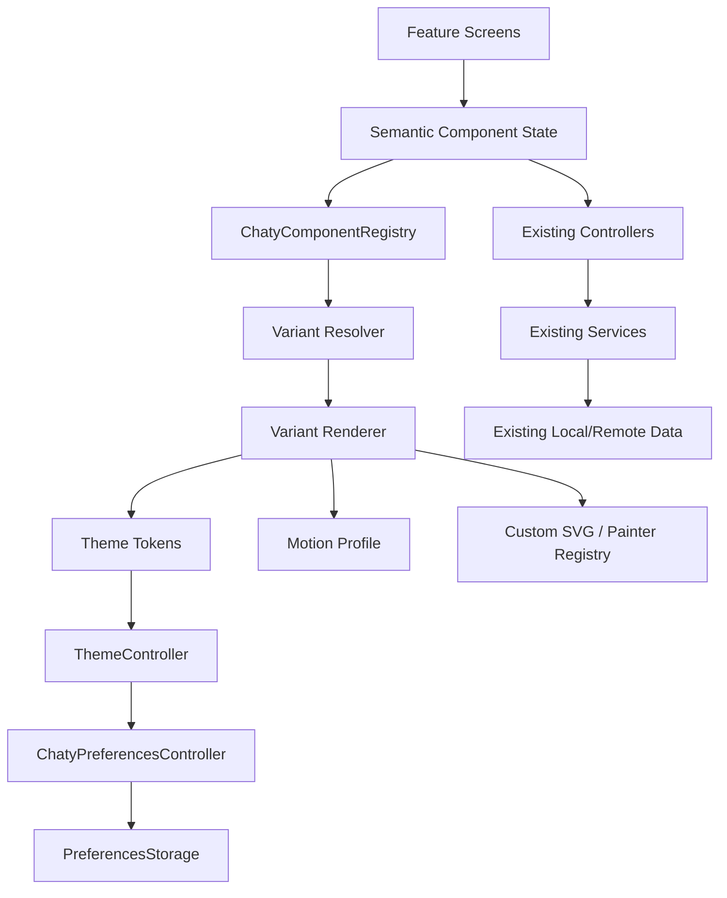

# Chaty Customization Architecture

## 1. Architecture goal

The current Chaty Clean Architecture remains intact. Add a presentation customization layer that sits inside the UI boundary and consumes semantic state without owning domain behavior.



## 2. Core rule

**Renderer selection is presentation state, not business state.**

For example, the message delivery system continues to emit `MessageStatus.read`. The tick registry maps that semantic state into the selected tick renderer.

## 3. Recommended new modules

```text
lib/ui/core/customization/
  chaty_component_registry.dart
  chaty_component_spec.dart
  component_variant_resolver.dart
  component_scope.dart
  customization_controller.dart
  customization_snapshot.dart
  customization_history.dart
  customization_migration.dart
  component_capabilities.dart
  performance_profile.dart

lib/ui/core/components/
  navigation/
    chaty_navigation_renderer.dart
    variants/
  headers/
    chaty_header_renderer.dart
    variants/
  composer/
    chaty_composer_renderer.dart
    variants/
  overlays/
    chaty_overlay_renderer.dart
    variants/
  reactions/
  lists/
  feedback/

lib/ui/core/design_system/
  tokens/
  theme/
  motion/
  icons/
  surfaces/

lib/ui/core/preview/
  component_preview_data.dart
  component_gallery_screen.dart
  preview_harness.dart
```

This does not require moving existing files on day one. Existing paths can be wrapped/adapted.

## 4. Component registry

```text
ComponentId
  navigation
  header
  composer
  bubble
  tick
  chat_list
  reaction_rail
  emoji_picker
  attachment_tray
  modal
  sheet
  action_sheet
  context_menu
  toast
  empty_state
  button
  text_field
  avatar
  wallpaper
  call_capsule
  pip
  camera_controls

VariantId
  component-local enum/string

ComponentSpec
  id
  variantId
  capabilities
  supportedScopes
  performanceCost
  accessibilityContract
  defaultMotionProfile
```

## 5. Capability negotiation

A variant can declare capabilities such as:

- compactWidth
- expandedWidth
- dark
- light
- highContrast
- largeText
- reducedMotion
- pointerInput
- keyboardInput
- touchInput
- rtl
- dynamicColor

The resolver chooses the selected variant when all required capabilities are satisfied; otherwise it falls back to a compatible variant in the same family.

## 6. Resolution algorithm

```text
1. read platform/accessibility capabilities
2. merge global theme + scoped overrides
3. read selected component variant
4. check variant capabilities
5. if unsupported, resolve nearest compatible variant
6. bind semantic state
7. render
8. emit telemetry/debug event in development builds only
```

No network request is needed to render a customization change.

## 7. Theme architecture

Existing `ThemeController` and `theme_config.dart` remain authoritative for global theme state.

Extend, do not replace:

```text
ThemeConfig
 ├─ semantic colors
 ├─ typography
 ├─ radius scale
 ├─ spacing scale
 ├─ elevation/depth
 ├─ component variants
 ├─ wallpapers
 ├─ effects
 ├─ icon family
 ├─ motion profile
 ├─ density profile
 └─ accessibility overrides
```

## 8. Theme merge model

Use field-level merge rather than whole-object replacement.

```text
Platform accessibility
        ↓
System defaults
        ↓
Global Chaty theme
        ↓
Screen override
        ↓
Conversation override
        ↓
Transient interaction state
```

## 9. Rendering architecture

### CustomPaint
Use for:

- bubbles
- ticks
- reaction effects
- certain navigation indicators
- specialized backgrounds
- waveform rendering
- custom icons/glyphs

### Stateless/Stateful widgets
Use for:

- semantic structure
- controls
- lists
- focus behavior
- gesture orchestration

### Repaint boundaries
Use around expensive independent regions:

- long message lists
- media previews
- animated wallpaper layers
- call PiP
- complex camera overlays

## 10. State ownership

| State | Owner |
|---|---|
| Message status | Domain/message service |
| Draft text | Chat detail / message draft state |
| Recording session | Voice note service/controller |
| Theme | ThemeController |
| Variant selection | CustomizationController / PreferencesController |
| Overlay stack | Global overlay host |
| Route/navigation state | Main navigation shell/controller |
| Call session | Call lifecycle/presentation controllers |
| Accessibility capability | Platform/window metrics |
| Preview state | Preview harness only |

## 11. Overlay manager

All modal, sheet, popover and menu surfaces should go through one conceptual `OverlayManager`.

Responsibilities:

- z-order
- focus restoration
- escape/back behavior
- outside interaction
- nested overlays
- anchor positioning
- available-height calculation
- safe insets
- animation lifecycle
- accessibility announcements

## 12. Adaptive architecture

Use `MediaQuery.sizeOf` for app-window dimensions and `LayoutBuilder` for local constraints. Avoid device-type checks for layout decisions. Flutter guidance explicitly recommends window-size based adaptive decisions and warns against assuming a device type tells you the usable app window.

Suggested tiers:

```text
< 600 logical px: compact composition
600–839: medium composition
>= 840: expanded composition
```

These are starting points, not hard platform identities. Components can define local breakpoints when needed.

## 13. No logic fork rule

Bad:

```text
WhatsAppComposer.send()
TelegramComposer.send()
SignalComposer.send()
```

Good:

```text
ComposerSemanticState
        ↓
ChatyComposerRenderer(selectedVariant)
        ↓
existing sendMessage / voice / attachment commands
```

## 14. File integration strategy

### Phase A — adapters
Wrap existing `ChatyAppBar`, composer, bubble painter, tick painter and modal system with variant-aware interfaces.

### Phase B — registry
Add variants one family at a time.

### Phase C — customization UX
Connect `ThemeEditorScreen`, `GBFeatureCenterScreen`, `UniversalAppearanceScreen`, `HomeScreenSettingsPage`, and `ConversationBubbleAndTicksScreen` to the same registry state.

### Phase D — QA harness
Add a gallery that renders all variants against identical synthetic content.

## 15. Build-time safety

No variant should require a new package.

All animation should use existing Flutter animation primitives and current Chaty motion abstractions.

All icons are custom SVG or existing Chaty painter assets. Do not import a general-purpose icon library for this work.
