# Chaty End-to-End Flow Specification

## 1. Global rendering flow

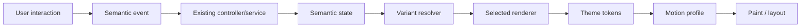

## 2. App startup → customized UI

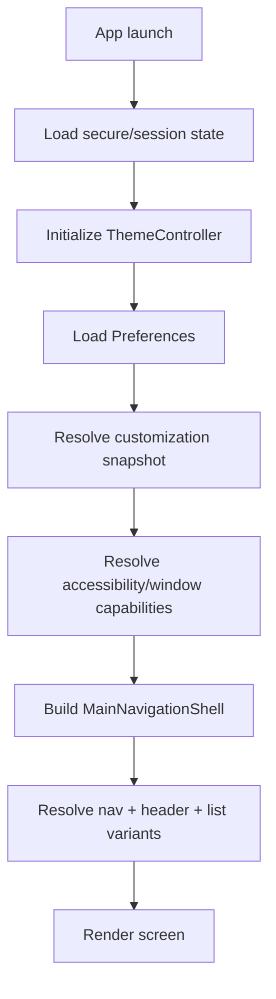

## 3. Bottom navigation flow

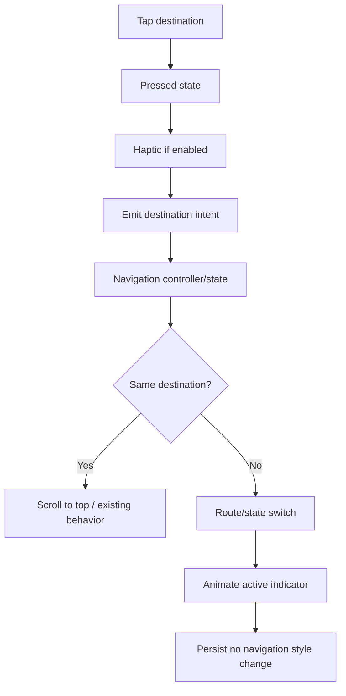

## 4. Header flow

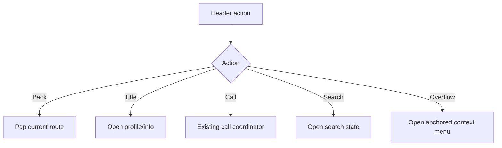

## 5. Chat composer flow

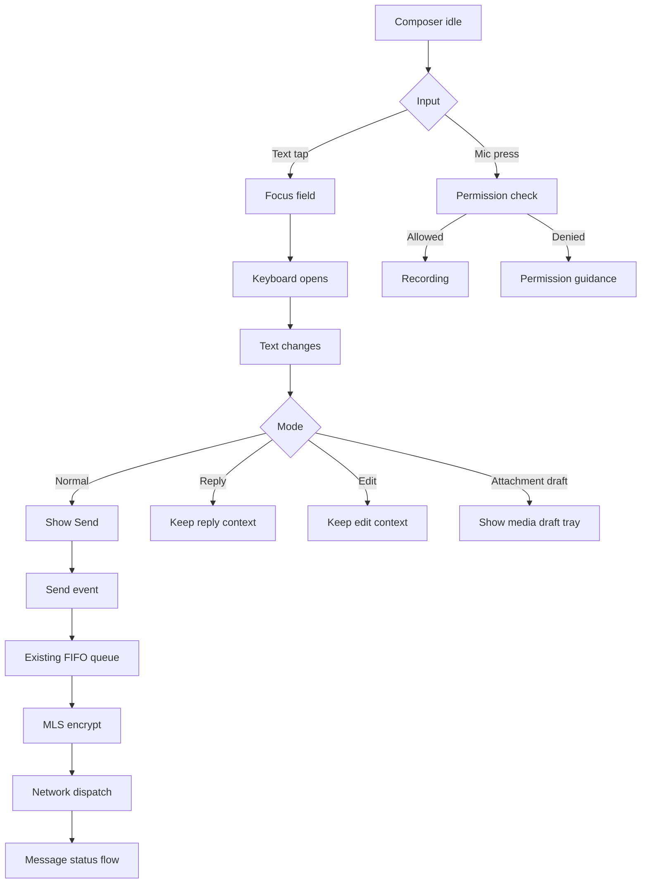

## 6. Message bubble flow

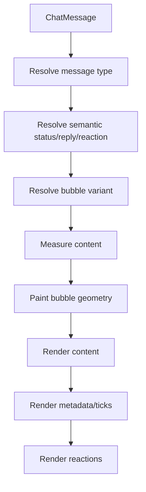

## 7. Message long-press flow

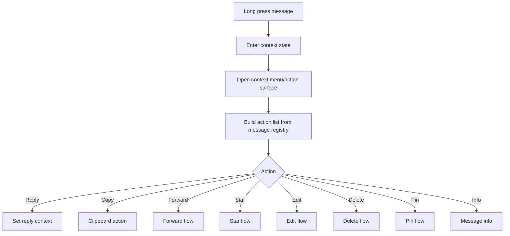

## 8. Reaction flow

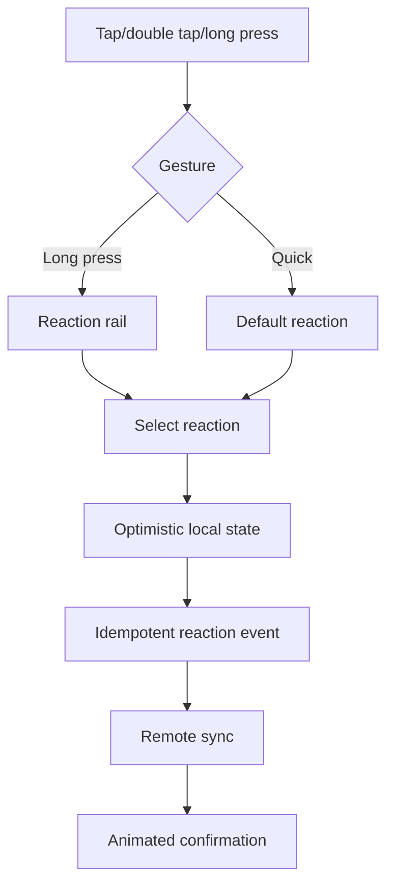

## 9. Attachment flow

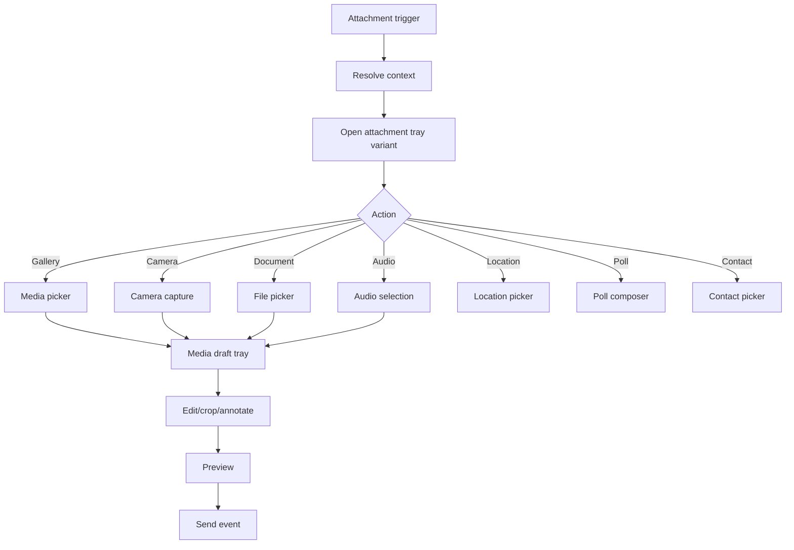

## 10. Modal flow

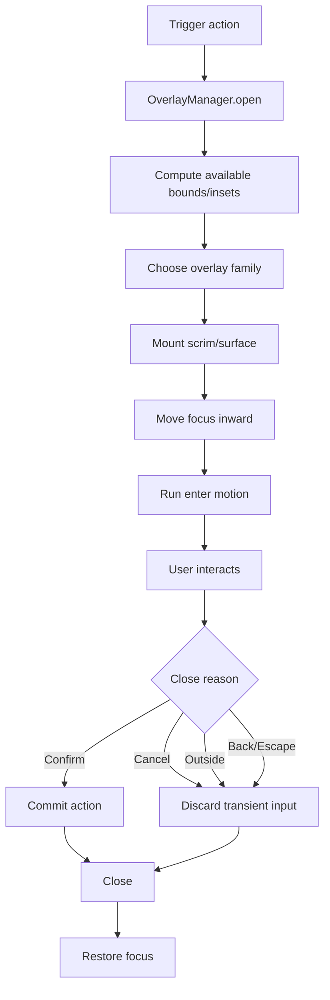

## 11. Customization live preview flow

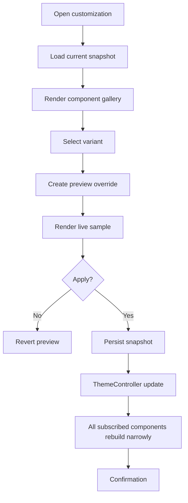

## 12. Chat-specific theme flow

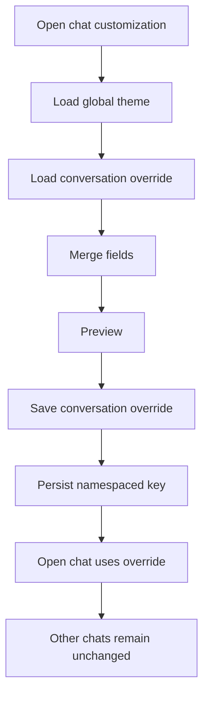

## 13. Recording flow

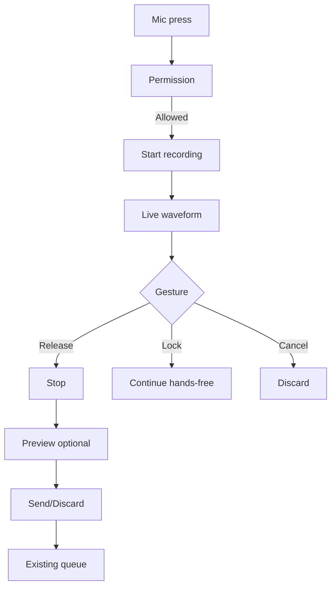

## 14. Media viewer flow

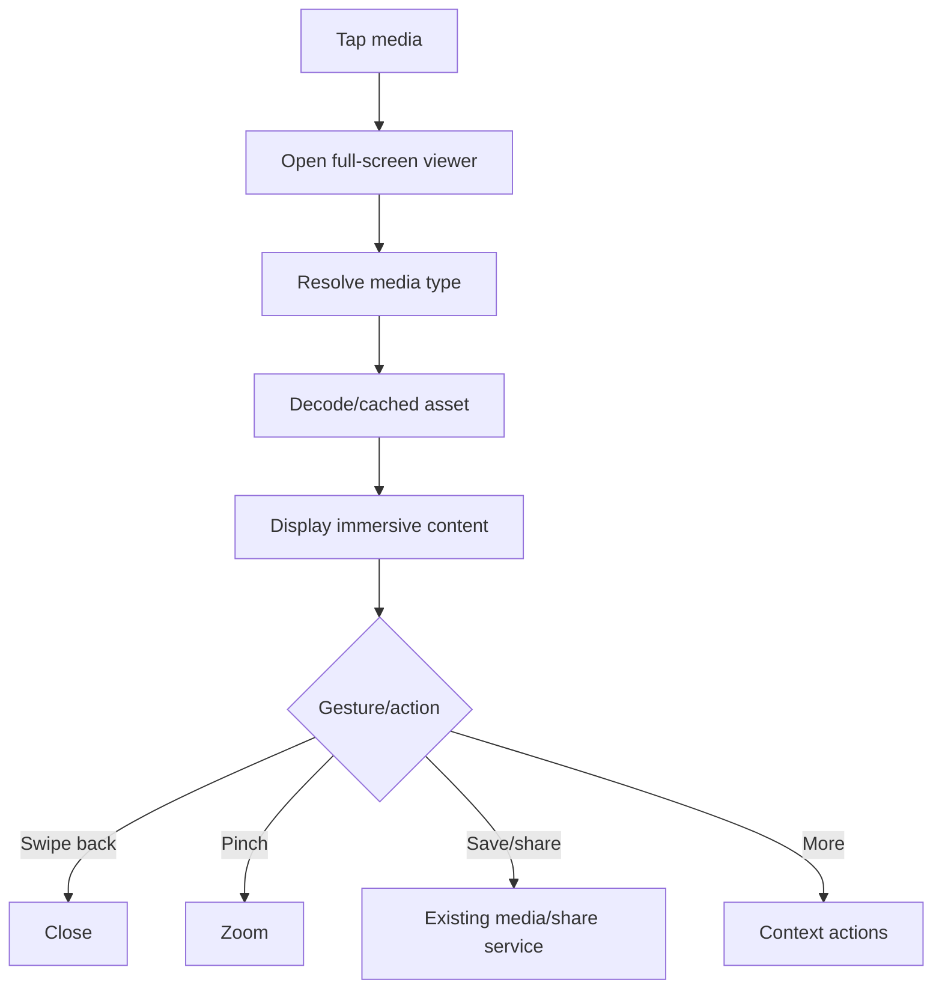

## 15. Call PiP flow

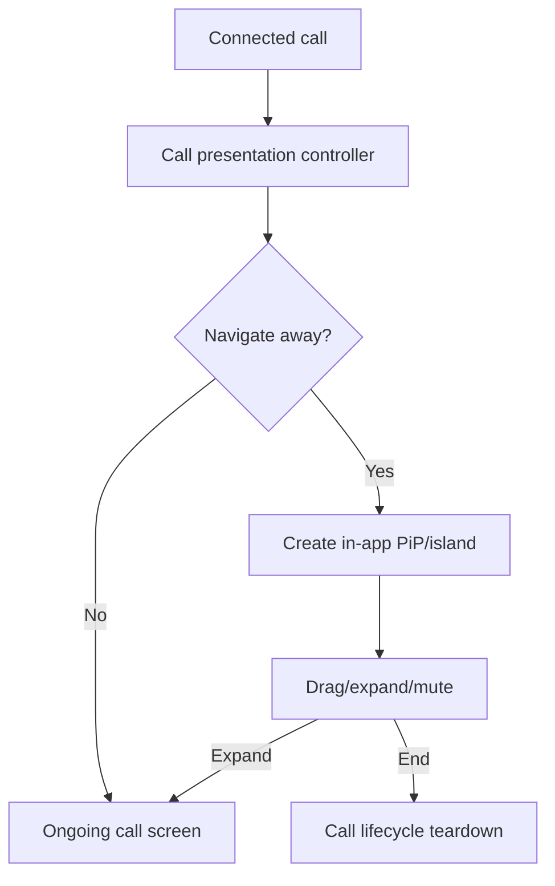

## 16. Stories/status flow

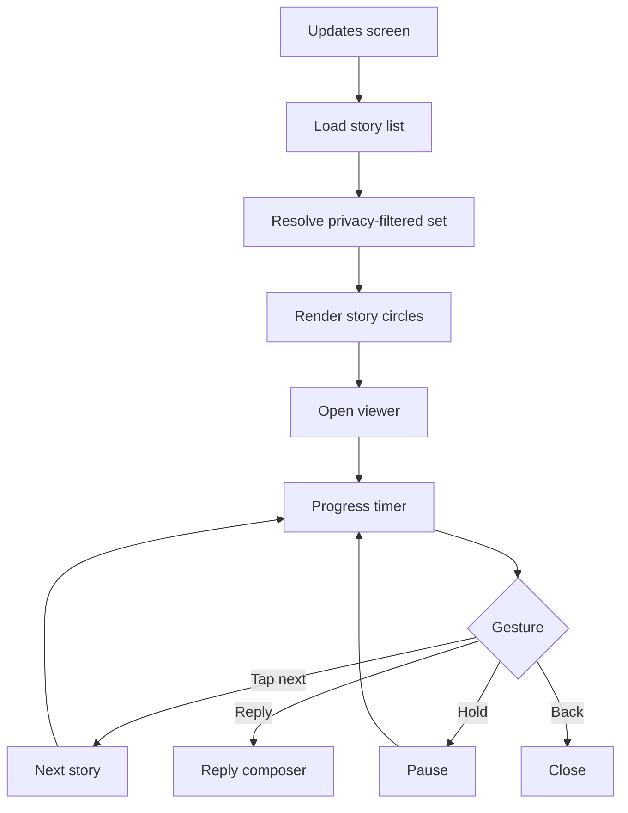

## 17. Settings control flow

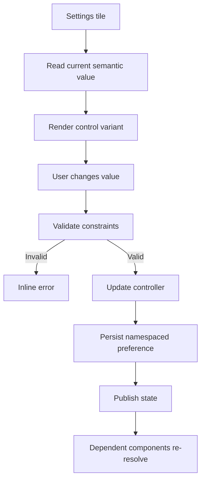

## 18. Generic component behavior template

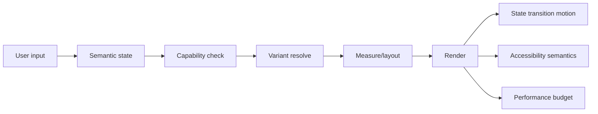

## 19. State flow for all interactive controls

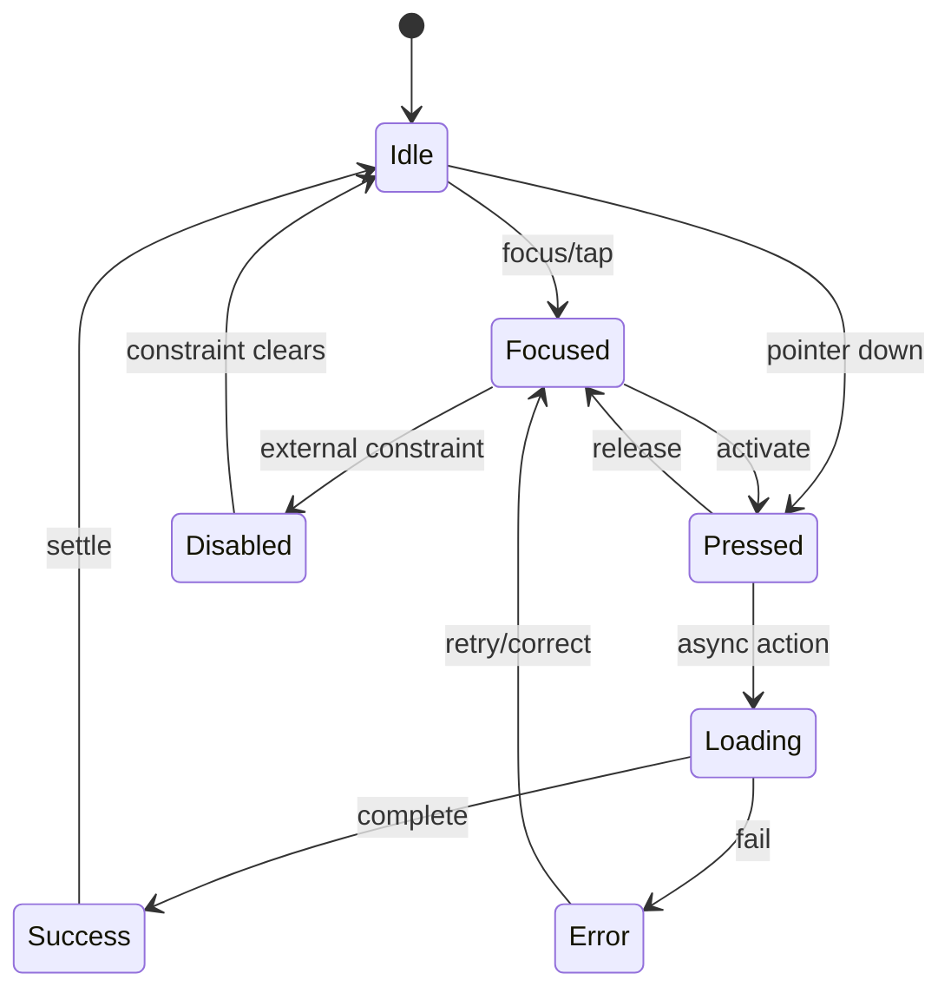

# 19. Primitive component micro-flows

## ChatyButton
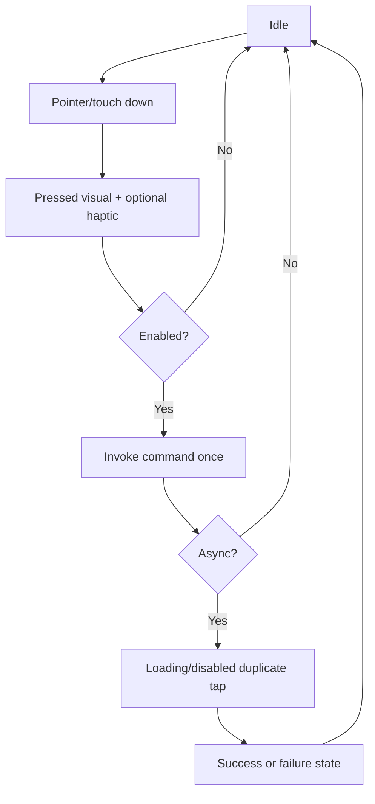

## ChatyTextField
```mermaid
flowchart TD
A[Unfocused] --> B[Focus]
B --> C[Focused]
C --> D[Input]
D --> E{Valid?}
E -->|Yes| F[Normal value state]
E -->|No| G[Inline error]
F --> H[Submit/next]
G --> H
H --> I[Persist/command]
```

## Switch / slider / radio
```mermaid
flowchart TD
A[Current value] --> B[User changes value]
B --> C[Clamp/validate]
C --> D[Optimistic visual update]
D --> E[Persist canonical setting]
E --> F{Success?}
F -->|Yes| G[Publish state]
F -->|No| H[Rollback + feedback]
G --> A
H --> A
```

## Avatar
```mermaid
flowchart TD
A[Identity] --> B{Cached asset?}
B -->|Yes| C[Render cached image]
B -->|No| D[Render placeholder]
D --> E[Fetch asset]
E --> F{Valid?}
F -->|Yes| G[Swap image]
F -->|No| H[Initials/fallback badge]
C --> I[Presence overlay]
G --> I
H --> I
```

## Toast / event banner
```mermaid
flowchart TD
A[Event] --> B[Classify severity]
B --> C{Blocking?}
C -->|Yes| D[Dialog/sheet contract]
C -->|No| E[Toast/banner]
E --> F{Action available?}
F -->|Yes| G[User action]
F -->|No| H[Auto dismiss]
G --> I[Execute command]
```

## Color tile / picker
```mermaid
flowchart TD
A[Current semantic color] --> B[Open picker]
B --> C[Create preview value]
C --> D[Contrast validation]
D --> E{Valid?}
E -->|Yes| F[Live preview]
E -->|No| G[Warn + nearest safe suggestion]
F --> H[Apply or Cancel]
H -->|Apply| I[Persist transaction]
H -->|Cancel| J[Discard preview]
```

## List row
```mermaid
flowchart TD
A[Render row] --> B{Gesture}
B -->|Tap| C[Open destination]
B -->|Swipe| D[Reveal row actions]
B -->|Long press| E[Context/selection mode]
D --> F{Action selected?}
F -->|No| A
F -->|Yes| G[Execute canonical action]
E --> H[Selection + action surface]
```

## Empty state
```mermaid
flowchart TD
A[No visible content] --> B{Loading?}
B -->|Yes| C[Skeleton/loading state]
B -->|No| D{Error?}
D -->|Yes| E[Recovery state]
D -->|No| F[Empty state]
F --> G[Primary next action]
E --> H[Retry]
```

## Context menu
```mermaid
flowchart TD
A[Long press / secondary input] --> B[Compute anchor]
B --> C[Compute available viewport]
C --> D[Choose menu position]
D --> E[Open focus-managed menu]
E --> F[Select action]
F --> G[Command registry]
G --> H{Destructive?}
H -->|Yes| I[Confirm dialog]
H -->|No| J[Execute]
```

## Media draft tray
```mermaid
flowchart TD
A[Attachment selected] --> B[Build local draft]
B --> C[Preview + metadata]
C --> D{Edit?}
D -->|Yes| E[Media editor]
E --> C
D -->|No| F{Remove?}
F -->|Yes| G[Delete draft item]
F -->|No| H[Send through existing composer]
```

## Task card
```mermaid
flowchart TD
A[Task summary] --> B{Tap}
B --> C[Open task detail]
C --> D{Status command}
D --> E[Validate workflow transition]
E --> F{Allowed?}
F -->|Yes| G[Persist transition]
F -->|No| H[Show reason]
G --> I[Update chat/task state]
```

## Call capsule / PiP
```mermaid
flowchart TD
A[Call active] --> B[Render capsule]
B --> C{User taps}
C -->|Expand| D[Restore call screen]
C -->|Drag| E[Constrain + move + snap]
C -->|Action| F[Mute/minimize/etc]
F --> G[Call controller]
```

## Camera lens picker
```mermaid
flowchart TD
A[Camera ready] --> B[Load effect registry]
B --> C[Render preview rail]
C --> D[User selects lens]
D --> E[Update effect engine]
E --> F[Render live preview]
F --> G[Capture]
G --> H[Create media draft]
```

## App lock overlay
```mermaid
flowchart TD
A[Protected transition] --> B[Show lock surface]
B --> C{Credential type}
C -->|Biometric| D[Platform biometric]
C -->|PIN| E[PIN verify]
C -->|Pattern| F[Pattern verify]
D --> G{Valid?}
E --> G
F --> G
G -->|No| H[Retry/backoff]
G -->|Yes| I[Unlock + resume original action]
```

## Search
```mermaid
flowchart TD
A[Open search] --> B[Focus field]
B --> C[Debounced query]
C --> D[Local index/filter]
D --> E{Need remote?}
E -->|Yes| F[Remote search]
E -->|No| G[Local results]
F --> H[Merge authoritative results]
G --> H
H --> I[Select result]
I --> J[Open destination]
```
