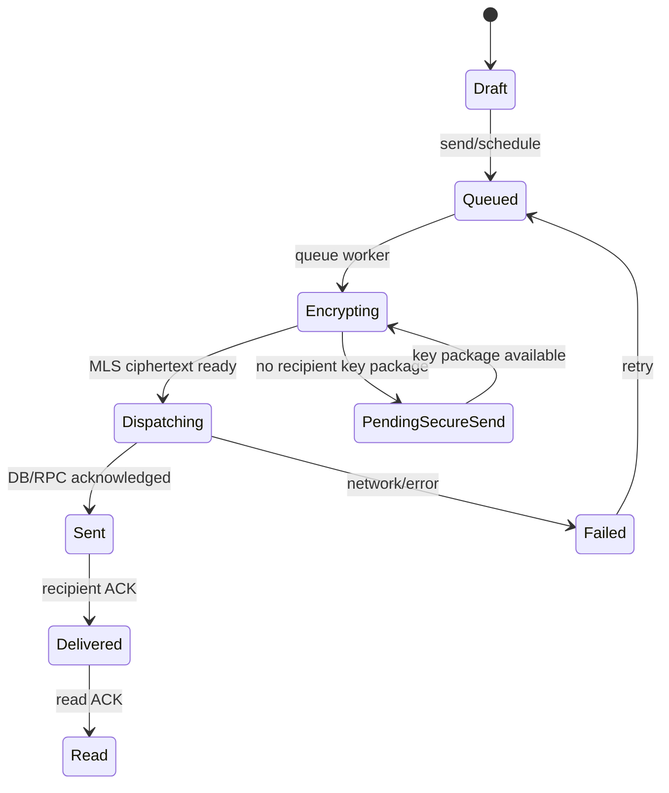
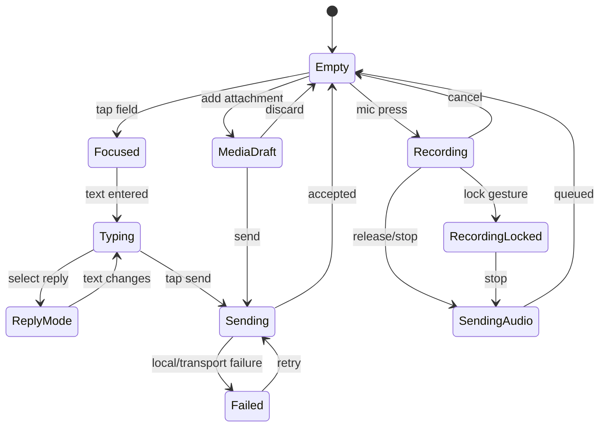

# Chaty Logic Specification

## 1. Canonical semantic contracts

### Navigation

```text
NavigationIntent(destination, source)
NavigationState(selectedDestination, stack, scrollRestorePolicy)
```

The renderer never decides where navigation goes.

### Header

```text
HeaderState(title, subtitle, avatar, actions, selectionCount, context)
HeaderAction(back, profile, search, call, video, overflow, custom)
```

### Composer

```text
ComposerMode = normal | reply | edit | recording | mediaDraft | scheduled | locked
ComposerState:
  text
  selection
  attachmentDrafts
  replyTo
  editMessageId
  recordingState
  sendCapability
  permissionState
```

### Bubble

```text
BubbleState:
  direction
  messageType
  status
  timestamp
  edited
  reply
  reactions
  selected
  failed
```

### Overlay

```text
OverlayRequest:
  type
  anchor
  modality
  dismissPolicy
  focusPolicy
  content
```

## 2. Variant resolution logic

```text
resolve(component, requestedVariant, scope, capabilities):
    merged = merge(scope overrides by precedence)
    candidate = requestedVariant or defaultVariant
    if candidate.supports(capabilities):
        return candidate
    fallback = registry.nearestCompatible(candidate, capabilities)
    if fallback exists:
        return fallback
    return familyDefault
```

## 3. Customization persistence

Preferences must remain namespaced per user, matching the current architecture.

Recommended keys:

```text
user_{id}_customization_schema
user_{id}_theme_global
user_{id}_nav_variant
user_{id}_header_variant
user_{id}_composer_variant
user_{id}_bubble_variant
user_{id}_tick_variant
user_{id}_chat_list_variant
user_{id}_reaction_variant
user_{id}_popup_variant
user_{id}_motion_profile
user_{id}_density_profile
user_{id}_conversation_override_{conversationId}
```

The existing preference system remains the persistence abstraction; these are logical names, not a mandate to bypass it.

## 4. Message send logic

The current FIFO/outbox behavior remains authoritative.



Visual skins only change the indicator rendered for each state.

## 5. Reaction idempotency

Every reaction mutation must be idempotent.

```text
key = conversationId + messageId + userId + reactionCode
```

Local state updates optimistically; repeated events converge to the same reaction state.

## 6. Composer state transitions



## 7. Recording safety logic

- Check microphone permission before starting.
- If denied, do not enter recording state.
- Start timer and waveform only after recorder confirms start.
- If the recording device interrupts, emit an interruption state and preserve the partial recording only when supported by current service behavior.
- Cancellation removes the draft and returns to the prior composer mode.
- Send is delegated to existing voice-note transport.

## 8. Modal logic

### Dismiss policy types

- `explicitOnly`
- `outsideAndExplicit`
- `outsideExplicitEscape`
- `blockingSecurity`

### Back priority

```text
nested picker/menu
→ current sheet/modal
→ current transient screen state
→ route stack
→ root navigation
```

## 9. Selection mode

Message multi-select must use a semantic selection controller.

```text
enterSelection(messageId)
addSelection(messageId)
removeSelection(messageId)
selectAll(scope)
clearSelection()
performBulkAction(action)
```

The header renderer shows selection count. The message renderer shows selection state. Neither owns selection logic.

## 10. Search logic

Use scoped search:

```text
Global search
  → chats/users/media/other categories

Conversation search
  → messages/media/links/docs within conversation
```

Search field behavior:

- focus on explicit search action
- preserve query when navigating back from results when appropriate
- empty query shows recent/suggested actions, not a blank expensive list
- no infinite animation while waiting for results

## 11. Theme apply transaction

```text
BEGIN
  validate snapshot
  resolve variants
  validate accessibility constraints
  store previous snapshot in history
  persist new snapshot
  publish ThemeState
COMMIT

onFailure:
  restore previous snapshot
  report recoverable error
```

## 12. Undo / reset

Undo history should be bounded, e.g. last 10 customization transactions.

A reset should be scoped:

- reset current component
- reset current screen
- reset current conversation
- reset all customization

Reset must not delete messages, tasks, calls, account state or security state.

## 13. Conversation theme logic

```text
getConversationTheme(conversationId):
    global = getGlobalTheme()
    override = getConversationOverride(conversationId)
    return merge(global, override)
```

Override values should contain only fields that differ from global.

## 14. Adaptive logic

Do not write:

```text
if (device == phone) ...
if (device == tablet) ...
```

Write:

```text
constraints = LayoutBuilder.constraints
if (constraints.maxWidth < compactBreakpoint) compact
else if (constraints.maxWidth < expandedBreakpoint) medium
else expanded
```

Use `MediaQuery.sizeOf` when the component needs the app-window size rather than local constraints.

## 15. Animation logic

Each animation defines:

```text
purpose
trigger
from
active
settle
cancel behavior
reducedMotion behavior
performance cost
```

No perpetual animation unless it communicates a live state (recording, call, progress, ambient status) and has a reduced-motion fallback.

## 16. Performance logic

A component should only rebuild when one of its consumed semantic fields changes.

Examples:

- one message delivery state change must not rebuild the full chat list
- changing navigation variant should rebuild navigation only plus dependent route shell surfaces
- changing global background color may repaint large areas, so batch the update into one publish transaction
- animated wallpaper must not cause unrelated chat bubbles to repaint

## 17. Accessibility logic

### Focus restoration

```text
open overlay
→ capture origin focus
→ move focus to first meaningful control
→ close overlay
→ restore origin focus where valid
```

### Reduced motion

```text
if systemReducedMotion:
   replace springs/particles with short opacity/state transitions
else:
   use selected motion profile
```

### Text scaling

Any component that cannot accommodate large text must adapt layout rather than clip.

## 18. Icon interaction logic

Visual SVG is separate from hit target:

```text
HitTarget >= platform/Chaty minimum
Glyph centered optically
Semantic label attached to hit target
```

## 19. Privacy/security boundary

Customization cannot change:

- message confidentiality
- encryption
- local lock enforcement
- locked-chat visibility policy
- presence privacy semantics
- anti-delete security semantics
- notification security semantics

## 20. Failure policy

Every async component action must define:

`idle / working / success / failure / retry / cancellation`

No silent failure for user-visible actions.
