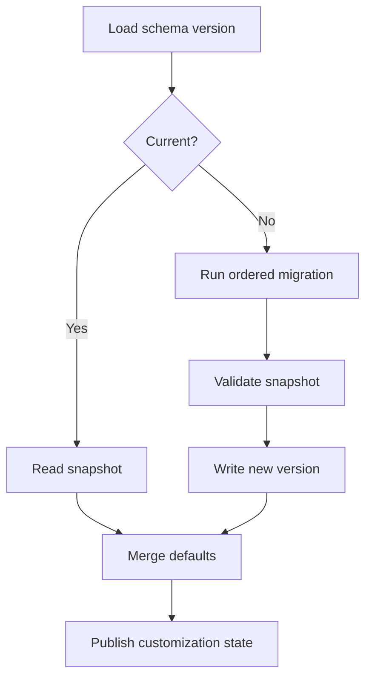

# Chaty Customization Memory Model

## 1. Purpose

`memory.md` defines what customization state should persist and how it relates to the existing `ChatyPreferencesController`, `PreferencesStorage` and migration system.

The model is intentionally scoped to presentation. Do not place secrets, tokens, passwords, cryptographic private keys or domain-sensitive payloads in this customization memory.

## 2. Snapshot structure

```text
CustomizationSnapshot
  schemaVersion
  globalTheme
  navigation
  header
  composer
  message
  reactions
  overlays
  list
  media
  wallpaper
  motion
  density
  accessibilityOverrides
  screenOverrides
  conversationOverrides
  metadata
```

## 3. Global customization

Persist:

- theme preset id
- custom color palette
- typography profile
- density profile
- navigation variant
- header variant
- composer variant
- bubble variant
- tick variant
- reaction variant
- popup/overlay family
- chat-list variant
- wallpaper id/reference
- effects profile
- motion profile

## 4. Per-conversation customization

Persist only deltas:

```text
conversationId
bubbleVariant?
tickVariant?
wallpaper?
composerVariant?
fontScale?
reactionVariant?
```

This prevents duplication and allows global changes to propagate everywhere else.

## 5. Migration



Migration rules:

- never discard unknown fields silently
- preserve old values when a field is still meaningful
- assign new fields safe defaults
- log migration version in debug builds

## 6. Scope merge

```text
platform
  + global
  + screen
  + conversation
  + transient
```

Merge is shallow at the field level with recursive handling for nested token groups.

## 7. Memory history

Customization transactions keep a bounded undo history.

```text
HistoryItem
  timestamp
  scope
  previousSnapshotDelta
  nextSnapshotDelta
  changedComponentIds
```

## 8. Reset semantics

### Component reset
Restores only the selected component family to global default.

### Screen reset
Clears screen-specific overrides.

### Conversation reset
Clears conversation delta and returns to the current global theme.

### Full reset
Restores built-in Chaty baseline snapshot.

No reset changes domain data.

## 9. Preview memory

Preview changes live in memory only until Apply.

```text
persistedSnapshot
     ↓
previewDraft (temporary)
     ↓
apply → persistedSnapshot
cancel → discard previewDraft
```

## 10. Cross-device behavior

Customization should be considered device-local by default unless the existing product explicitly adds a secure sync mechanism. The visual system should not accidentally create cross-device preference coupling through message synchronization.

## 11. Memory safety

Store compact identifiers instead of whole rendered assets.

Prefer:

- preset id
- SVG asset id
- palette values
- numerical token overrides
- wallpaper asset reference

Avoid persisting:

- decoded image buffers
- animation controllers
- widget instances
- network sessions
- credentials

## 12. Default snapshot

The default snapshot must reproduce current Chaty behavior and current default appearance as closely as practical. It is the regression anchor.

## 13. Versioning contract

`schemaVersion` is independent from app version.

Example:

```text
v1 → original preferences
v2 → namespaced customization fields
v3 → component registry identifiers
v4 → per-conversation delta format
```

A downgrade-safe strategy should be considered where feasible, but forward migration is the mandatory path.
