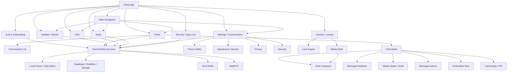
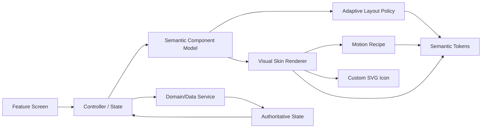
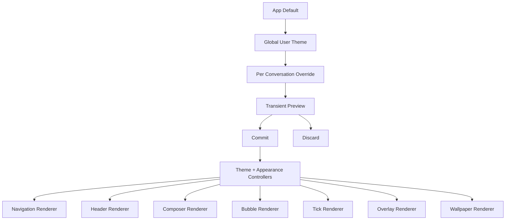
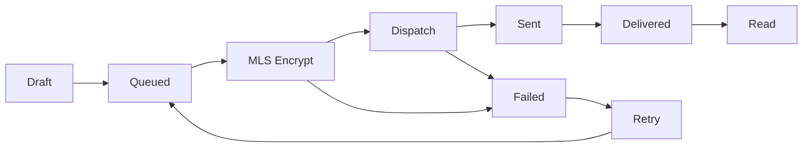

# Chaty Project Graph — System and Component Dependency Map

## 1. Product graph



## 2. UI architecture graph



## 3. Customization dependency graph



## 4. Message lifecycle graph



## 5. “Single source of truth” graph

```text
User action
   │
   ▼
Visual component
   │  emits semantic command
   ▼
Controller / coordinator
   │
   ├── validation
   ├── permissions/capability
   └── service invocation
          │
          ▼
Authoritative domain state
          │
          ▼
Reactive controller state
          │
          ▼
Only affected renderers rebuild
```

## 6. Variant containment rule

```text
FORBIDDEN:
NavigationSkin -> Supabase
BubbleSkin -> MessageRepository
ModalSkin -> PreferencesStorage
TickSkin -> DeliveryStateMachine

ALLOWED:
NavigationSkin -> semantic navigation item
BubbleSkin -> semantic message
ModalSkin -> semantic modal model
TickSkin -> MessageStatus
```

This graph is the guardrail against creating one business-logic implementation per visual theme.
